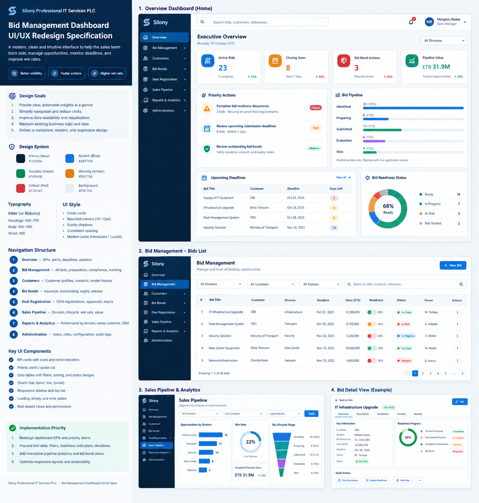

# UI/UX Modernization Specification — Bid Management Dashboard

## Instructions for Claude Code

Act as a senior product designer and senior frontend engineer. Review the existing repository and implement a polished, modern, production-quality UI/UX redesign for the bid and tender management dashboard.

**Primary goal:** Improve the dashboard’s visual hierarchy, usability, responsiveness, and operational clarity while preserving existing business logic, integrations, data structures, and working features.

Do not rebuild the application from scratch unless the current architecture makes that unavoidable. First inspect the codebase, identify its framework and design conventions, and then implement the redesign in the existing stack.

## 1. Before Making Changes

1. Inspect the repository structure, README, package files, routing, current dashboard components, styling system, and available assets.
2. Identify the frontend framework, component library, charting library, icon library, state management, API/data layer, and existing tests.
3. Run the application or relevant checks if possible and inspect the current dashboard implementation.
4. Identify which displayed metrics and workflows are backed by real application data.
5. Write a short implementation plan before editing files.
6. Preserve current routes, API contracts, authentication, permissions, and business logic.

Do not invent new backend endpoints or replace real data with hard-coded values. If a field or metric is not available, omit it or clearly label the placeholder during development. Do not display illustrative figures as if they were live business data.

## 2. Product Context

This is an enterprise bid/tender and sales operations dashboard, intended to help management and sales teams understand:

- Active bids and tenders.
- Submission deadlines and upcoming closing dates.
- Bid preparation and compliance/document readiness.
- Bid bond status, expiry, and outstanding actions.
- OEM/vendor deal registration status.
- Sales pipeline and opportunity progress.
- Bid ownership, division responsibility, and next actions.
- Reporting and performance across divisions, customers, sales owners, and OEMs.

The dashboard should answer these questions quickly:

1. What needs attention now?
2. Which bids are closing soon?
3. Which bids are blocked or incomplete?
4. Who owns each action?
5. What is the current pipeline and its status?
6. Which bid bonds or registrations need follow-up?

## 3. UX Principles

- **Action-oriented:** Prioritize tasks, risks, deadlines, and blockers over decorative charts.
- **Scannable:** Use clear headings, concise labels, consistent spacing, and readable data tables.
- **Consistent:** Establish reusable design tokens and components.
- **Responsive:** Support desktop, tablet, and mobile layouts.
- **Accessible:** Use semantic HTML, keyboard navigation, visible focus states, accessible labels, and sufficient contrast.
- **Trustworthy:** Show accurate data, timestamps where relevant, clear empty states, and meaningful loading/error states.
- **Efficient:** Provide useful search, filters, sorting, pagination, and direct access to details.
- **Maintainable:** Reuse existing components where appropriate and avoid unnecessary dependencies.

## 4. Visual Direction

Create a clean, contemporary enterprise SaaS interface. Avoid excessive gradients, heavy shadows, crowded cards, decorative charts, and too many bright status colors.

### Suggested color tokens

Use these as starting values, adapting to the existing brand and accessibility requirements:

- Primary/navy: `#10243A`
- Primary blue: `#2477D4`
- Page background: `#F5F7FA`
- Surface/card background: `#FFFFFF`
- Main text: `#172B3A`
- Secondary text: `#667085`
- Border: `#E4E7EC`
- Success: `#16845B`
- Warning: `#D97706`
- Critical/error: `#C24141`
- Informational: `#2477D4`

Status colors must not be the only way status is communicated; always include a readable text label or icon with an accessible label.

### Typography and spacing

- Prefer the project's existing font if appropriate; otherwise use Inter or a system sans-serif stack.
- Establish a consistent type scale for page titles, section headings, card labels, table text, and helper text.
- Use an 8-point-based spacing rhythm where practical.
- Use restrained card borders, subtle shadows only when useful, and consistent corner radii (approximately 8–12px).
- Ensure table content and form controls remain readable at common laptop resolutions.

## 5. Application Shell and Navigation

Implement or refine a consistent application shell:

- Left sidebar with clear icons and labels.
- Collapsible sidebar on desktop if suitable for the existing layout.
- Mobile navigation that does not consume excessive screen space.
- Top bar with page title/breadcrumbs as appropriate, global search if supported, notifications if already supported, and user/profile controls if present.
- Visually clear active navigation state.
- Group navigation items logically.

Suggested navigation, adapted to actual existing routes and permissions:

1. Overview
2. Bid Management
3. Customers
4. Bid Bonds
5. Deal Registration
6. Sales Pipeline
7. Reports & Analytics
8. Administration

Do not create nonfunctional navigation items. If a suggested module does not exist, do not pretend it is implemented; keep the existing information architecture or mark the item as out of scope.

## 6. Dashboard Overview

Create a clear executive overview page with the following hierarchy.

### 6.1 Page header

- Title: “Executive Overview” or the existing product’s appropriate dashboard title.
- Optional short subtitle describing the current view.
- Date range and division filters only if the data layer supports them.
- A primary action such as “Create Bid” or “New Opportunity” only if that action already exists and the user has permission.

### 6.2 KPI cards

Show a small, useful set of KPI cards using actual available data. Possible metrics:

- Active bids.
- Bids closing soon.
- Bid readiness/compliance issues.
- Bid bonds requiring action.
- Total pipeline value, if reliably calculated.
- Win rate, if the required historical data exists.

Each card should contain:
- A concise label.
- A prominent value.
- Optional comparison/trend only if meaningful data is available.
- A clear click-through destination when the card is actionable.
- A tooltip or short explanation for ambiguous metrics.

Avoid filling the page with too many cards. Prefer 4–6 high-value KPIs based on the data actually available.

### 6.3 Priority actions

Add a prominent “Priority Actions” or “Needs Attention” section for issues such as:

- Bids with approaching deadlines.
- Missing or incomplete required documents.
- Incomplete readiness/compliance checks.
- Bid bonds expiring or requiring issuance/release follow-up.
- Deal registrations awaiting approval or renewal.

Only show action types supported by actual data. Each item should communicate the issue, relevant bid/customer, owner if known, due date if known, and a direct link to the relevant record.

Sort by urgency using clear, explainable rules. Do not invent urgency scores.

### 6.4 Pipeline visualization

If the application has reliable stage/status data, include a compact visualization of bids/opportunities by lifecycle stage, for example:

- Identified
- Preparing
- Submitted
- Under Evaluation
- Won
- Lost

Use the actual statuses defined by the application. Do not force these labels if the system uses a different lifecycle.

Provide clear labels and values, accessible colors, tooltips where supported, and a way to navigate from a stage to its matching records. If there is insufficient data for a chart, use a clear summary or table instead.

### 6.5 Recent activity or upcoming deadlines

Where supported by current data, include a concise list of recent activity or upcoming deadlines. Each row should identify the bid, event/action, owner if available, and date/time if available.

Avoid adding fabricated activity or timestamps.

## 7. Bid Management Table

Treat the bid list as a core workflow, not a secondary report.

### Required UX improvements

- Search by relevant fields supported by the application.
- Filters for status, division, owner, customer, deadline, OEM, and readiness when those fields exist.
- Sortable columns with visible sort state.
- Pagination or virtualization for large lists, following the existing data architecture.
- Sticky table header when useful.
- Consistent row height and alignment.
- Readable status badges with text labels.
- Clear empty, loading, and error states.
- Responsive behavior: use a horizontal-scroll table on smaller screens or a compact card/list view if that better fits the existing app.
- Row click behavior should be clear and should not conflict with buttons or checkboxes.
- Preserve bulk actions if present, including selection feedback and confirmation for destructive actions.

Potential columns, subject to the actual schema:

- Bid/tender title and reference.
- Customer.
- Division.
- Owner.
- Submission deadline.
- Bid value, if available.
- Readiness/progress.
- Bid bond status, if relevant.
- Current status.
- Actions.

Do not overload the table with every possible field. Keep high-frequency decision-making fields visible and put secondary details on a detail page, drawer, or expandable row if that pattern already fits the application.

## 8. Bid Readiness and Compliance

Where the current product tracks readiness or required documents:

- Show a simple completion indicator and a clear textual state.
- Distinguish complete, incomplete, blocked, and not applicable where supported.
- Provide a way to inspect missing requirements.
- Make blockers actionable: identify the missing item and link to the place where it can be resolved.
- Do not treat an unknown state as complete.
- Do not infer compliance from incomplete data.

## 9. Bid Bonds and Deal Registration

If these modules exist, use consistent patterns for their list and detail views.

### Bid bonds

Make the following easy to scan when available:

- Related bid/customer.
- Bond type and amount.
- Issuance/status.
- Expiry date.
- Required next action.
- Responsible owner.

Use warning states for approaching expiry only when an agreed rule exists. Make the expiry window configurable if the application already supports configuration; otherwise use a clearly documented constant rather than an unexplained threshold.

### Deal registration

Show, where available:

- OEM/vendor.
- Customer and opportunity.
- Registration reference.
- Status/approval.
- Submission or expiry date.
- Owner and next action.

Keep labels consistent with the existing backend and business terminology.

## 10. Filters and Search

- Make active filters visible.
- Provide a clear “Reset filters” action when filters are applied.
- Preserve filters when navigating back to the list if consistent with the current architecture.
- Debounce free-text search where appropriate.
- Do not trigger unnecessary API requests on every keystroke if the current API supports debouncing or explicit submission.
- Ensure filters work together and that the displayed result count reflects the actual result set.
- Make filter controls keyboard-accessible and properly labeled.

## 11. Interaction and Component Details

Create or refine reusable components for:

- Application sidebar and top bar.
- Page header and breadcrumb.
- KPI card.
- Status badge.
- Search/filter toolbar.
- Data table and pagination.
- Priority action item.
- Progress/readiness indicator.
- Empty state.
- Loading skeleton.
- Error state with retry where appropriate.
- Confirmation dialog.
- Toast/feedback messages if already supported.

Interactions must work. Do not implement decorative buttons that do nothing. Preserve existing behavior, validation, permission checks, and error handling. Destructive actions should require suitable confirmation.

Use the icon library already installed in the project. If no icon library exists, prefer the lightest suitable option and avoid introducing a large dependency solely for decoration.

## 12. Responsive Layout

### Desktop

- Sidebar and top bar form a stable application shell.
- Dashboard uses a balanced grid with appropriate whitespace.
- KPI cards align consistently.
- Tables use the available width without excessively wide columns.
- Primary actions remain easy to find.

### Tablet

- Sidebar may collapse.
- KPI cards should reflow naturally.
- Filter controls should wrap without overlap.
- Charts and tables should remain usable.

### Mobile

- Avoid horizontal page overflow.
- Prioritize the most important metrics and tasks.
- Use compact navigation.
- Stack cards and filter controls.
- Make interactive targets comfortably tappable.
- Tables may use horizontal scrolling or a suitable mobile list pattern.
- Do not hide critical status or deadline information without an alternative.

## 13. Accessibility

- Use semantic landmarks and heading hierarchy.
- Provide accessible names for icon-only buttons.
- Ensure keyboard access and visible focus.
- Use sufficient text/background contrast.
- Do not rely on color alone for status.
- Associate labels and validation messages with form fields.
- Support reduced motion if animations are used.
- Ensure charts have text labels or an equivalent summary.
- Avoid unnecessary animation and avoid motion that distracts from operational information.

## 14. Data Integrity and Engineering Constraints

These are mandatory:

- Preserve current APIs, database schema, authentication, authorization, and business logic unless a change is essential and explicitly justified.
- Do not fabricate data, trends, activity, values, or success states.
- Do not silently change the meaning of existing statuses or calculations.
- Reuse the existing state management, data-fetching, routing, and component libraries where practical.
- Keep TypeScript types accurate if the project uses TypeScript.
- Avoid duplicating business logic in UI components.
- Avoid introducing dependencies without a clear benefit.
- Do not remove existing features just to simplify the design.
- Follow the project's linting, formatting, and coding conventions.
- Keep components focused and reusable, but avoid overengineering.
- Preserve environment configuration and secrets; never hard-code credentials.
- Respect role-based access and permissions for actions and navigation.

## 15. Loading, Empty, and Error States

Every data-driven section should handle:

- Loading: use skeletons or a restrained loading indicator.
- Empty: explain that there are no matching records and provide a useful next step when appropriate.
- Error: show a clear message and retry action when possible.
- Partial data: show available information without implying missing information is valid or complete.
- Long values: truncate visually where appropriate while allowing users to inspect the full value.
- Dates: use the app’s established date/time format and timezone conventions.

Avoid flashing misleading zero values while data is loading.

## 16. Performance

- Avoid unnecessary re-renders and expensive client-side calculations.
- Reuse existing charting tools.
- Lazy-load heavy components only when useful and consistent with the project.
- Do not fetch the same data repeatedly when existing caching patterns can be reused.
- Avoid rendering huge lists without pagination or virtualization.
- Keep the UI responsive during filtering and navigation.

## 17. Implementation Process

Proceed in manageable stages:

### Stage 1 — Audit
Inspect the repository and report:
- Framework and relevant dependencies.
- Current dashboard route and components.
- Existing data sources and schemas.
- Existing styles/design system.
- Existing functionality that must be preserved.
- Any uncertainties or blockers.

### Stage 2 — Design foundation
Implement consistent color/spacing/typography tokens and shared layout primitives in the existing styling approach.

### Stage 3 — Dashboard overview
Redesign the application shell, KPI cards, priority actions, pipeline summary, and deadline/activity area using real data.

### Stage 4 — Core tables and workflows
Improve bid list, filters, readiness indicators, and relevant bond/registration screens that already exist.

### Stage 5 — Responsive and accessible behavior
Test desktop, tablet, and mobile layouts; keyboard navigation; loading/error/empty states; and contrast.

### Stage 6 — Validation
Run available lint, type-check, test, and build commands. Fix issues introduced by the redesign. Report any checks that could not be run.

Do not stop after producing a plan unless a real blocker requires clarification. After the audit and brief plan, proceed with implementation.

## 18. Acceptance Criteria

The work is complete when:

- The dashboard looks materially more modern, cohesive, and professional.
- Visual hierarchy makes urgent actions and deadlines easy to identify.
- KPI cards use actual data and have meaningful labels.
- Bid tables are readable, searchable, filterable, and sortable to the extent supported by the existing application.
- Statuses and readiness are clear and consistent.
- Navigation and actions lead to valid destinations and work correctly.
- Desktop, tablet, and mobile layouts are usable without accidental overflow.
- Loading, empty, and error states are implemented for relevant data-driven areas.
- Accessibility basics are addressed.
- Existing backend contracts and business behavior remain intact.
- No fake data is presented as live information.
- Available lint/type-check/tests/build checks pass, or remaining failures are documented with their cause.

## 19. Final Report from Claude Code

When finished, provide a concise report containing:

1. What changed.
2. Main files/components changed.
3. Features and interactions implemented.
4. Any assumptions or limitations.
5. Commands/checks run and their results.
6. Any recommended follow-up work.

**Start by inspecting the existing repository. Adapt this specification to the actual application rather than blindly imposing assumptions.**

---

# 20. Visual Reference — Sample UI Screenshots

Use the image below as a **visual direction reference** for the redesign. It contains sample concepts for:
- Executive overview dashboard with KPI cards, priority actions, pipeline, upcoming deadlines, and readiness.
- Bid management list with search, filters, status badges, readiness, and pagination.
- Sales pipeline and analytics.
- Bid detail view with key information, readiness progress, documents, and quick actions.
- A proposed color palette, typography, navigation structure, and reusable UI components.

### How to interpret this reference

- Treat the screenshot as a design concept, not as a source of truth for application data, labels, business rules, or exact screen dimensions.
- Do not copy the illustrative KPI values, customer names, dates, pipeline figures, or other sample data as real production data.
- Recreate the layout using the actual application's framework, data model, routes, and existing design conventions.
- Prefer real reusable components and functional controls over a static screenshot recreation.
- Adapt the design to the current application and preserve all existing working functionality.
- If the current app's brand identity differs, retain the established brand while following the reference's clean hierarchy, restrained color use, and whitespace.
